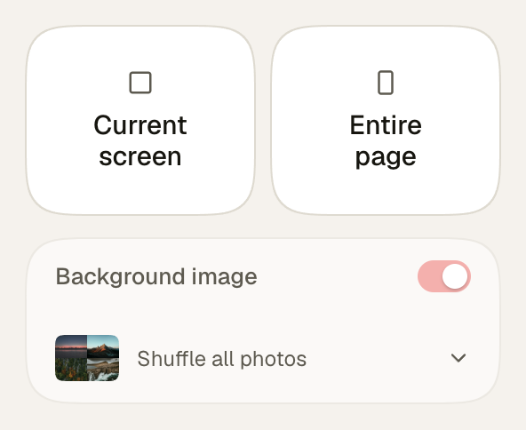
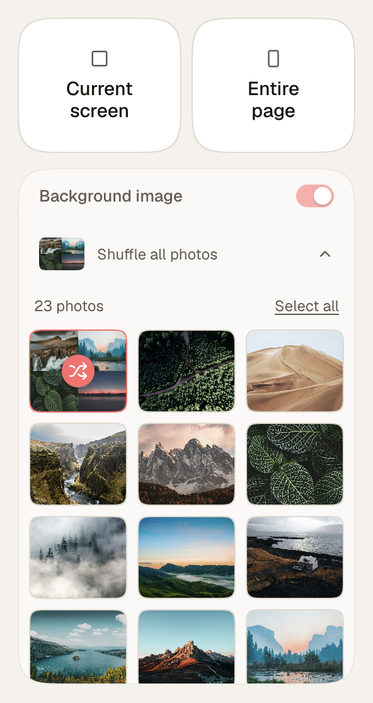
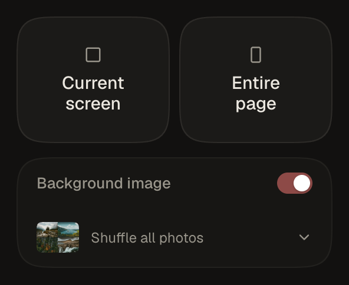
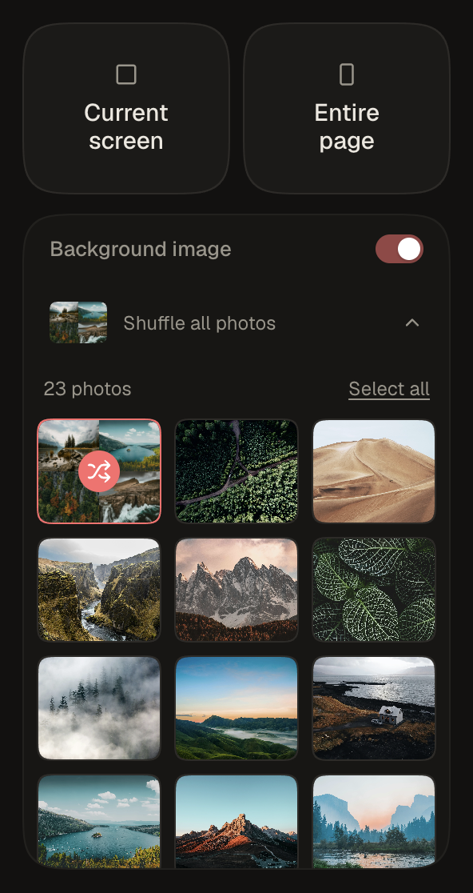

<p align="center">
  
</p>

<h1 align="center">Backdrop</h1>

<p align="center">Capture the visible area or the whole page, and frame it on a landscape photo from Unsplash.</p>

[Install from the Chrome Web Store](https://chromewebstore.google.com/detail/backdrop-%E2%80%94-screenshots-wo/omeobpnjkmohdoeikgpfnfiipemidflk)

<p align="center">
  
</p>

<p align="center">
  
</p>

<p align="center">
  
</p>

<p align="center">
  
</p>

## Install (unpacked)

1. Open `chrome://extensions`
2. Turn on **Developer mode** (top right)
3. **Load unpacked** → pick this folder
4. Pin the extension so it's one click away

Then open any page, click the icon and pick **Full screen** or **Full page**. Chrome asks
where to save the image. Shots on a background are saved as JPEG at 90% quality (about 5×
smaller than PNG for a photo); plain captures stay PNG, which is smaller and sharper for UI.

## How it behaves

- **Full screen** — exactly what's on screen, at your display's pixel density.
- **Full page** — scrolls the page one screen at a time and stitches the slices into one
  tall image. Works on app layouts too: if the document itself doesn't scroll, it finds the
  largest scrolling panel and captures that, keeping the UI around it in place.
- **Sticky and fixed bits** — sticky headers stop following the scroll, and fixed overlays
  (chat bubbles, cookie bars) show up once at the top instead of on every slice. Everything
  is put back exactly as it was afterwards, scroll position included.
- **Backgrounds** — nine Unsplash photos (see [Credits](#credits)). The shot is centred with
  rounded corners and a soft two-layer shadow on a 16:10 crop of the photo. Tap to toggle:
  pick one to always use it, several to shuffle between them, or none to save the raw
  capture. Your picks are remembered.

## Limits

- Chrome allows two visible-tab captures per second, so a full-page shot takes about half a
  second per screen.
- Very tall pages cap out around 32,000 px (the canvas limit).
- Fixed or sticky elements inside shadow DOM aren't caught.
- Chrome pages (`chrome://`, the Web Store) can't be captured by any extension.

## Layout

```
manifest.json          MV3 manifest — permissions, icons, popup, worker
background.js          service worker: capture, full-page stitching, backgrounds
popup.html             toolbar popup: the two capture buttons and background toggles
popup.js               remembers background picks, sends the capture request
backgrounds/           <name>.webp, Unsplash photos resized to 3072 px wide
icons/                 icon.svg source + rendered PNGs
screenshots/           the images in this README
```

Full-page capture uses `captureVisibleTab` slices rather than the DevTools protocol:
Chrome only paints what's in the viewport, so a single CDP capture of a long page repeats
the first screen. Stitching happens on an `OffscreenCanvas` in the worker, so nothing is
injected into the page beyond the scroll and style tweaks, which are undone when it's done.

## Credits

The code is [MIT](LICENSE). Background photos from [Unsplash](https://unsplash.com)
are not covered by it; they stay under the [Unsplash License](backgrounds/LICENSE).

| Background | Photo by |
| --- | --- |
| Forest Road | [Patrick Dzieza](https://unsplash.com/photos/qJhwq8vulK4) |
| Dunes | [Keith Hardy](https://unsplash.com/photos/UVyavSwslOg) |
| Canyon | [Jack Millard](https://unsplash.com/photos/zjyP-UYI-ko) |
| Meadow | [Damian Markutt](https://unsplash.com/photos/7N998BynnFw) |
| Autumn | [Felix Bacher](https://unsplash.com/photos/-jEEnRx38wo) |
| Fittonia | [Josefin](https://unsplash.com/photos/sbovFdDUk3s) |
| Tower | [Lai Man Nung](https://unsplash.com/photos/BtzBvzbTYxo) |
| Fog | [Dave Hoefler](https://unsplash.com/photos/od287vQyufw) |
| Braies | [Joel Vodell](https://unsplash.com/photos/TApAkERW5pQ) |
| Sørvágsvatn | [Annie Spratt](https://unsplash.com/photos/vI-uFNolpLA) |
| Pilatus | [Kevin Schmid](https://unsplash.com/photos/zdsMxyby0nE) |
| Laki | [Tomáš Malík](https://unsplash.com/photos/Oph_Fs9bWwg) |
